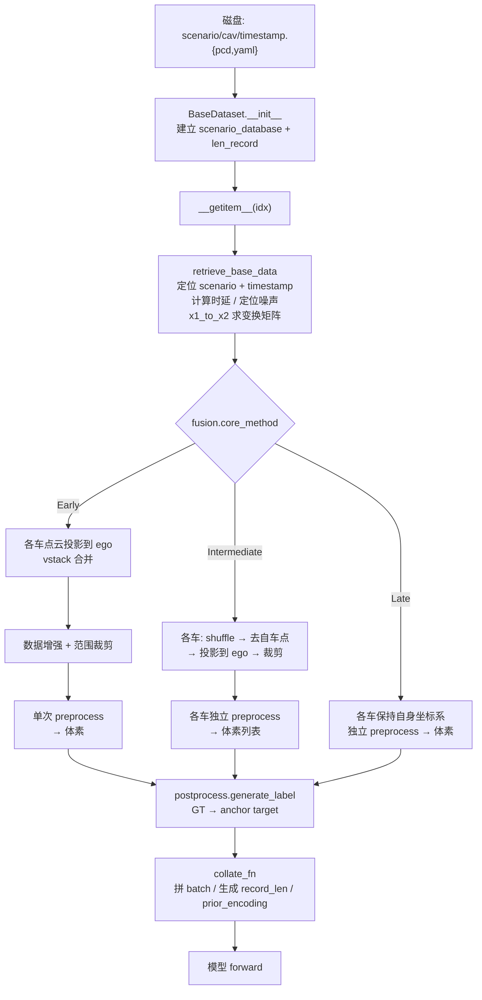

# 04 数据流水线

本文回答一个问题：**磁盘上的 `.pcd` + `.yaml`，如何变成网络能吃的一批张量？**

---

## 1. 磁盘上的数据组织

```
opv2v_data_dumping/
├── train/
│   ├── 2021_08_22_21_41_24/          # 一个 scenario（一次 CARLA 录制）
│   │   ├── data_protocol.yaml        #   采集时的仿真参数（log replay 用）
│   │   ├── 1732/                     #   一个 CAV（文件夹名 = 智能体唯一 id）
│   │   │   ├── 00000.pcd ... 00700.pcd          # 点云
│   │   │   ├── 00000.yaml ... 00700.yaml        # 元数据 / 标注
│   │   │   └── 00000_camera0.png ...            # 4 路环视相机（0前/1右后/2左后/3后）
│   │   └── 1780/
│   └── ...（OPV2V 全库共 73 个 scenario，按 train/validate/test 划分）
├── validate/
├── test/
└── test_culvercity/                  # 跨城市泛化测试集
```

**命名约定**（务必记住，代码大量依赖）：

| 约定 | 含义 | 代码影响 |
|---|---|---|
| 时间戳为 5 位数字、10 Hz | `00000` ~ `00700` | `time_delay // 100` 把 ms 折算成帧 |
| 单文件 = 单帧雷达 | `.pcd` 与同名 `.yaml` 一一对应 | `timestamp + '.yaml'` / `'.pcd'` 拼接 |
| **RSU 的 folder id 为负数**（如 `-1`） | 路侧单元 | `infra` 标志：`1 if int(cav_id) < 0 else 0` |
| 每个 CAV 的帧数相同 | 同 scenario 内对齐 | `len_record` 只按第一辆车的帧数累加 |

### 1.1 单帧 yaml 的关键字段

```yaml
lidar_pose: [x, y, z, roll, yaw, pitch]   # 雷达在 CARLA world 下的位姿（角度单位为度）
vehicles:                                 # 周围目标标注，key = 目标 id（至少被本车雷达打到 1 个点）
  <object_id>:
    location: [x, y, z]                   # CARLA actor 位置
    angle:    [roll, yaw, pitch]          # actor 朝向
    center:   [dx, dy, dz]                # 包围盒中心相对 actor 的偏移
    extent:   [ex, ey, ez]                # 包围盒半长（half extent）
    speed: 8.3
    ...
ego_speed: 32.1                           # km/h，用于 prior_encoding（除以 30 归一化）
camera0_calibration: ...                  # 相机内参/外参（相机 track 用）
```

> 这四个字段（`location` / `angle` / `center` / `extent`）是 `box_utils.project_world_objects` 实际读取的（`box_utils.py:461-465`），缺少任何一个都会在训练时 KeyError。包围盒尺寸不是直接给 `w/l/h`，而是由 `extent`（**半长**，即 CARLA 的 extent）经 `create_bbx` 生成 8 角点——注意 `create_bbx` 的 docstring 写的是「Width, height, length」，容易让人误以为是全尺寸，实际代码用的是 `±extent`。
>
> 另注意：`lidar_pose` 中角度单位是**度**，`x_to_world()` 内部用 `np.radians` 转弧度。

---

## 2. 场景库索引（`BaseDataset.__init__`）

`basedataset.py:118-188` 在初始化时**一次性扫描全部文件路径**，构建三层嵌套字典：

```python
scenario_database = {
  0: {                                    # scenario 索引（按文件夹名排序后的序号）
    '1732': {                             # cav_id
        '00000': {'yaml': '...', 'lidar': '...', 'camera0': [...4 个路径]},
        '00001': {...},
        'ego': True                       # 特殊 key：标记该车是否 ego
    },
    '-1': {'ego': False, ...},            # RSU 被排到列表末尾
  },
  1: {...}
}

len_record = [701, 1382, ...]             # 累积帧数，用于 idx → (scenario, timestamp) 映射
```

三个关键细节（都容易踩坑）：

1. **ego 的选择**：并非随机，而是 **id 排序后第一个**的车辆（`j == 0`）。但若列表首位是负 id（RSU），会先把它移到末尾（`basedataset.py:140-141`）——所以 RSU 永远不会被选为 ego。
2. **`max_cav` 截断**：`if j > self.max_cav - 1: break`，超出部分的车**连索引都不建立**，直接丢弃（会打印 `too many cavs`）。
3. **`len_record` 只按第一辆车累加**：代码注释明确「Assume all cavs will have the same timestamps length」。若某车缺帧，索引会错位。

`__len__` 返回 `len_record[-1]`，即全库总帧数；一个样本 = 一个 (scenario, timestamp)，内含该时刻所有在通信范围内的车。

---

## 3. 按索引取原始数据（`retrieve_base_data`）

`basedataset.py:199-263`。以 `idx` 为输入，输出**未经任何坐标变换**的原始数据：

```python
data = OrderedDict({
  cav_id: {
    'ego': bool,
    'time_delay': int,          # 该车的时延（帧数）
    'params': dict,             # 元数据：lidar_pose / vehicles / transformation_matrix / ...
    'lidar_np': np.ndarray      # (N, 4) 原始点云（取自延迟帧！）
  }, ...
})
```

执行顺序：

```
idx
 ├─ ① 遍历 len_record 定位 scenario_index
 ├─ ② timestamp_index = idx - len_record[scenario_index-1]（首场景不减）
 ├─ ③ timestamp_key = '00078' 之类的字符串
 ├─ ④ calc_dist_to_ego()：算每车到 ego 的平面距离，写入 cav_content['distance_to_ego']
 ├─ ⑤ 对每个 cav：
 │    ├─ time_delay = time_delay_calculation(is_ego)   # ego 恒为 0
 │    ├─ timestamp_delay = max(0, timestamp_index - time_delay)
 │    ├─ reform_param()  ← 核心：算变换矩阵 + 用当前帧 GT 覆盖延迟帧 GT
 │    └─ lidar_np = pcd_to_np(cav_content[timestamp_key_delay]['lidar'])  # ★ 读延迟帧
```

### 3.1 变换矩阵的三种情形

`reform_param()`（`basedataset.py:404-475`）是所有坐标系逻辑的中枢。设：

- `P_cav(t_d)`：该车在**延迟时刻**的雷达位姿
- `P_ego(t_c)`：ego 在**当前时刻**的位姿
- `P_ego(t_d)`：ego 在延迟时刻的位姿

| 情形 | `transformation_matrix` | `spatial_correction_matrix` | 谁用 |
|---|---|---|---|
| `cur_ego_pose_flag=True`（**代码默认**） | `x1_to_x2(P_cav(t_d), P_ego(t_c))` | `I` | 绝大多数中间融合（V2VNet / F-Cooper / Where2comm 等） |
| `cur_ego_pose_flag=False`（需在 yaml 显式设置） | `x1_to_x2(P_cav(t_d), P_ego(t_d))` | `x1_to_x2(P_ego(t_d), P_ego(t_c))` | **V2X-ViT**（`point_pillar_v2xvit.yaml` 显式写 `cur_ego_pose_flag: False`） |
| GT 专用（永远如此） | `gt_transformation_matrix = x1_to_x2(P_cav(t_c), P_ego(t_c))` | — | 后处理/评估 |

其中：

```python
# transformation_utils.py:57-79
x1_to_x2(x1, x2) = inv(x_to_world(x2)) @ x_to_world(x1)
```

含义：把 x1 坐标系下的点变换到 x2 坐标系。**注意 `cur_ego_pose_flag=False` 时故意用「过去的 ego 位姿」做投影**，以模拟真实场景中「其他车投影时 ego 还在上一帧位置」，而 STTF 模块随后用 `spatial_correction_matrix` 把特征 warp 回当前时刻——这正是 V2X-ViT 处理时延对齐的机制。

> 两个开关彼此独立：`proj_first` 决定「点云级还是特征级对齐」，`cur_ego_pose_flag` 决定「对齐到当前还是过去的 ego」。代码里 `proj_first` 默认为 `True`，`cur_ego_pose_flag` 也默认为 `True`；V2X-ViT 只显式改了后者。

### 3.2 一个刻意为之的「不一致」

```python
delay_params['vehicles'] = cur_params['vehicles']    # ★ 标注用当前帧
```

即：**输入点云是延迟帧的，标注（GT）是当前帧的**。目的是公平评估——要预测的是「现在」的目标，但输入被人为滞后。这也是为什么 `time_delay` 会作为先验编码送入模型（让网络知道「这条特征有多旧」），而不是被隐藏。

---

## 4. 三种融合 Dataset 的差异

三者都继承 `BaseDataset`，共享读盘逻辑，只在 `__getitem__` 分叉。

### 4.1 `EarlyFusionDataset`（早期融合）

```
for cav in cavs(距离 <= 70m):
    lidar → 投影到 ego → 范围裁剪
    vstack 所有车的点云                    # ★ 只有一份点云
↓ augment（翻转/旋转/缩放）               # ★ 仅此处调用数据增强
↓ mask_points_by_range（合并后再裁一次）
↓ preprocess(合并点云)                    # ★ 单次体素化
```

特点：融合发生在**物理层**，体素内可能混有来自不同车的点，因此能获得最细粒度的互补信息，但带宽最高（要传原始点云）。

### 4.2 `LateFusionDataset`（晚期融合）

```
for cav in cavs:
    lidar → 只做范围裁剪，不投影到 ego    # ★ 保持在自身坐标系
    各自 preprocess + forward
↓ 每车输出检测框，用各自 transformation_matrix 投影到 ego
↓ 全部框汇总 → NMS
```

特点：
- **训练时只返回 1 辆车**（`random.choice` 随机选一个 CAV 当 `'ego'`），因为晚期融合的每辆车是独立的单车检测任务，随机采样等价于对全体 CAV 做数据增广（`late_fusion_dataset.py:108-122`）；
- **测试时返回全部车的多个 key**，因为每辆车都要独立推理再投影到 ego（`get_item_test`）。
- 带宽最低（只传框），但信息损失最大。

### 4.3 `IntermediateFusionDataset`（中间融合，★ 重点）

`intermediate_fusion_dataset.py:56-243`。两个开关决定形态：

```python
self.proj_first = True            # 默认：先把点云投到 ego，再体素化
self.cur_ego_pose_flag = True     # 默认：用当前 ego 位姿做投影
```

**`proj_first=True`（默认，多数方法）**

```
for cav in cavs(距离 <= 70m):
    ① shuffle_points                 # 打乱点序（防止体素内点数偏差）
    ② mask_ego_points                # 剔除打在自车车身上的点
    ③ 投影点云到 ego：p[:, :3] = T @ p[:, :3]
    ④ mask_points_by_range           # 裁剪到 cav_lidar_range
    ⑤ preprocess → 体素化            # ★ 每车单独体素化
    → processed_features 列表追加一份
↓ merge_features_to_dict             # {'voxel_features': [f1, f2, ...], ...}
```

此时 `pairwise_t_matrix[:, :] = I`（因为点云已在 ego 系，无需再 warp）。

**`proj_first=False`（V2VNet 论文原始设定 / 需要显式 warp 的场景）**

点云保持自身坐标系，体素化后由融合模块用 `pairwise_t_matrix` 做特征级 warp：

```python
# intermediate_fusion_dataset.py:443-452
T[i, j] = inv(T_j) @ T_i     # i→j：TiPi = TjPj ⇒ Tj⁻¹TiPi = Pj
```

> ⚠️ **本仓库 23 个 yaml 里没有任何一个真正开启 `proj_first: false`**：只有 `point_pillar_v2vnet.yaml:16` 显式写了 `proj_first: true`，其余全部走默认 `True`。因此**所有自带配置的 `pairwise_t_matrix` 都是全 I**，V2VNet 的 `warp_affine` 实际是恒等变换（融合退化为「拼 ego 特征 + conv + 池化 + ConvGRU」）。想复现论文里的特征级 warp，必须自己在 `fusion.args` 里加 `proj_first: false`。
>
> 而且一旦开启 `proj_first: false`，会踩到一个**索引错位**：`get_pairwise_transformation()` 按 `base_data_dict` 里**全部 CAV**（含被 70 m 规则过滤掉的）建立 `(max_cav, max_cav)` 矩阵，而 `__getitem__` 里的特征列表只保留范围内的车。于是 `pairwise_t_matrix[b][:N, :N]` 与 `record_len[b]=N` 的行列对应关系就可能错。默认 `proj_first=True`（全 I）时这个 bug 被掩盖，见 [07 §2](07_扩展与注意事项.md) 约束 #16。

> 关键 trade-off：`proj_first=True` 让几何对齐发生在**点云级**（更精确，但每车独立体素化会产生各自的网格、可能需要重新采样）；`proj_first=False` 让对齐发生在**特征级**（可用双线性 warp，便于压缩与通信，但会引入插值误差）。这也是 CoAlign 等「位姿纠错」方法关注的痛点。

### 4.4 输出字典（单样本）

```python
processed_data_dict['ego'] = {
    'object_bbx_center':  (100, 7) float,   # 补零到 max_num 的 GT 框（hwl 顺序）
    'object_bbx_mask':    (100,)   float,   # 1=有效，0=padding
    'object_ids':         list,             # 去重后的目标 id（yaml vehicles 的 key，用于推理时匹配）
    'anchor_box':         (H//fs, W//fs, 2, 7),  # 预生成 anchor（H/W 来自 anchor_args，fs=feature_stride）
    'processed_lidar':    dict,             # {'voxel_features': [...], 'voxel_coords': [...], ...}
    'label_dict':         dict,             # {'pos_equal_one', 'neg_equal_one', 'targets'}
    'cav_num':            int,              # ★ 本帧实际参与的车数
    'velocity':           (max_cav,)        # 每车速度/30
    'time_delay':         (max_cav,)        # 每车时延（帧）
    'infra':              (max_cav,)        # 1=RSU, 0=V2V
    'spatial_correction_matrix': (max_cav, 4, 4)
    'pairwise_t_matrix':  (max_cav, max_cav, 4, 4)
}
```

**目标去重**（`intermediate_fusion_dataset.py:133-136`）：多车标注会重复包含同一目标，用 `object_ids` 的 `set()` 去重。顺序由 `set` 决定，**每次运行可能不同**，但配合 `object_ids` 列表使用时保持一致。

### 4.5 还有一个 V2 变体（只服务于 FPV-RCNN）

`intermediate_fusion_dataset_v2.py` 的 `IntermediateFusionDatasetV2` 与 §4.3 有三点实际差异：

1. 额外保留每车的 `projected_lidar`（供两阶段的 `VoxelSetAbstraction` 采样原始点）；
2. 跳过点数 ≤ 10 的车（`if len(projected_lidar) > 10`），避免空点云进 VSA；
3. 顶部 `import points_in_boxes_cpu`，**必须编译 `pcdet_utils`** 才能 import。

只有 `fpvrcnn_intermediate_fusion.yaml` 用它；`ciassd_intermediate_fusion.yaml` 用的仍是普通 `IntermediateFusionDataset`。

---

## 5. 预处理：点云 → 体素

默认 `SpVoxelPreprocessor`（`sp_voxel_preprocessor.py`），底层调用 spconv 的 `VoxelGenerator`：

```python
# 输出
voxel_features   : (M, 32, 4)   # M=非空体素数，32=每体素最大点数，4=[x,y,z,intensity]
voxel_coords     : (M, 4)       # [batch_idx, z_idx, y_idx, x_idx]  ★ 注意顺序
voxel_num_points : (M,)         # 每个体素的实际点数（用于 mask padding）
```

参数：`max_points_per_voxel=32`（单个体素超出部分丢弃）、`max_voxel_train=32000` / `max_voxel_test=70000`（单帧最多保留的体素数，超出按扫描顺序丢弃；因为点云在 `get_item_single_car` 里已 `shuffle_points`，效果近似随机采样）。

> **坐标系顺序的坑**：`voxel_coords` 是 `[batch, z, y, x]`，这在 `PillarVFE` 中被明确使用——
> `f_center[:, :, 0]` 用 `coords[:, 3] * voxel_x`（x 在最后一列），`coords[:, 1]` 对应 z。写自定义 VFE 时若按 `[batch, x, y, z]` 理解会全错。

`VoxelPreprocessor` 是纯 numpy 版本：特征维度是 **7**（`xyz+intensity` 再拼「点到体素均值的偏移」），且**不产出 `voxel_num_points`**，与 `PillarVFE` 期望的 4 维输入不兼容，仅供教学参考。

对比一下三者的输出 key：

| 预处理器 | key | 特征维度 |
|---|---|---|
| `SpVoxelPreprocessor`（默认） | `voxel_features` / `voxel_coords` / `voxel_num_points` | 4 |
| `VoxelPreprocessor`（numpy 教学版） | 只有 `voxel_features` / `voxel_coords` | 7 |
| `BevPreprocessor`（PIXOR） | 只有 `bev_input` | `(H+1, L, W)` 占据体，末通道存平均 intensity；与 3D backbone 不通用 |

---

## 6. 后处理：两个截然不同的职责

同名 "postprocessor" 承担两件事，容易混淆：

### 6.1 训练期：GT → anchor target（`generate_label`）

在 `__getitem__` 里调用，输出 `label_dict`：

| key | 形状 | 含义 |
|---|---|---|
| `pos_equal_one` | `(H, W, 2)` | 正样本掩码 |
| `neg_equal_one` | `(H, W, 2)` | 负样本掩码 |
| `targets` | `(H, W, 14)` | 每个 anchor 的 7 维回归目标 |

详见 [03 配置系统](03_配置系统.md) 第 4 节。

### 6.2 推理期：模型输出 → 3D 框（`post_process`）

`voxel_postprocessor.py:236-347`：

```
psm (B,2,H',W') ─sigmoid─→ prob ─reshape(1,-1)─→ 逐元素与 score_threshold 比较 ─→ 候选
rm  (B,14,H',W') ─delta_to_boxes3d─→ (B, H'*W'*2, 7)
        ↓ 用 transformation_matrix 把框投到 ego（中间融合时为 I）
        ↓ 转 8 角点 → 转 2D standup box
        ↓ 剔除超大框 / 异常 z
        ↓ 旋转 NMS（nms_thresh=0.15）
        ↓ 用 GT_RANGE 过滤掉范围外的框
→ pred_box3d (N, 8, 3), scores (N,)
```

> `score_threshold` 取自 yaml（V2VNet `0.20`、V2X-ViT `0.27`），代码里没有硬编码；`nms_thresh` 同样来自 `postprocess.nms_thresh`。

`generate_gt_bbx` 则直接用当前帧 GT 生成评估用框。

### 6.3 Collate：单样本 → batch

`intermediate_fusion_dataset.py:276-366`。这是**理解 `record_len` 的关键**：

```python
# 每帧的体素列表被拼接，用 batch 索引区分归属
merged_feature_dict = merge_features_to_dict(processed_lidar_list)   # 跨样本、跨车全部打平
processed_lidar_torch_dict = pre_processor.collate_batch(merged_feature_dict)
#   voxel_coords 第一列 = 全局「车级条目」序号（0..Σn_cav-1），不是样本号、也不是 batch 内的车序号！
record_len = tensor([n_cav_1, n_cav_2, ...])        # (B,)
prior_encoding = stack([velocity, time_delay, infra], dim=-1)   # (B, max_cav, 3)
```

Collate 后的 batch 结构：

| key | 形状 | dtype | 说明 |
|---|---|---|---|
| `processed_lidar.voxel_features` | `(ΣM, 32, 4)` | float32 | 全 batch 所有车所有体素 |
| `processed_lidar.voxel_coords` | `(ΣM, 4)` | int | `[car_entry_idx, z, y, x]`，`car_entry_idx ∈ [0, Σn_cav)` |
| `processed_lidar.voxel_num_points` | `(ΣM,)` | int | — |
| `record_len` | `(B,)` | int64 | 每样本车数 |
| `prior_encoding` | `(B, L, 3)` | float32 | `[speed/30, delay, infra]` |
| `pairwise_t_matrix` | `(B, L, L, 4, 4)` | float32 | `proj_first=True` 时全为 I |
| `spatial_correction_matrix` | `(B, L, 4, 4)` | float32 | 时延纠偏 |
| `object_bbx_center` | `(B, 100, 7)` | float32 | — |
| `object_bbx_mask` | `(B, 100)` | float32 | — |
| `label_dict.targets` | `(B, H, W, 14)` | float32 | — |
| `label_dict.pos_equal_one` | `(B, H, W, 2)` | float32 | — |

> `record_len` 与 `voxel_coords[:, 0]` 的语义**不同**：前者是「每个样本有几辆车」，后者是「这个体素属于第几个车的特征」（全局连续编号）。`regroup()` 依赖前者把打平的特征还原成 `(B, L, C, H, W)`。

---

## 7. 数据增强：一个容易被忽略的事实

`intermediate_fusion_dataset.py` 中**完全没有调用 `self.augment()`**（已通过全局 grep 确认）：

```
basedataset.py:526        定义 augment()
early_fusion_dataset.py:100   ✅ 调用
late_fusion_dataset.py:81     ✅ 调用
intermediate_fusion_dataset.py  ❌ 未调用
```

因此 `point_pillar_v2vnet.yaml`、`point_pillar_v2xvit.yaml` 等配置里的 `data_augment` 段落**对中间融合不生效**，属于无效配置。若你发现中间融合模型过拟合，这是第一个可以改进的点（需注意：中间融合的增强必须在**投影到 ego 之后、体素化之前**做，且要同步变换所有车的点云与 GT，实现上比早期融合复杂）。

---

## 8. 完整链路一图


